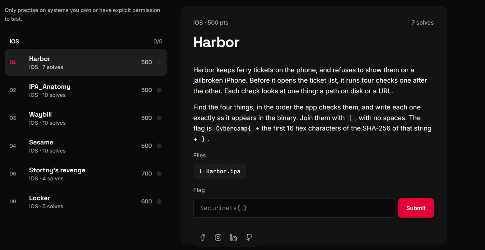
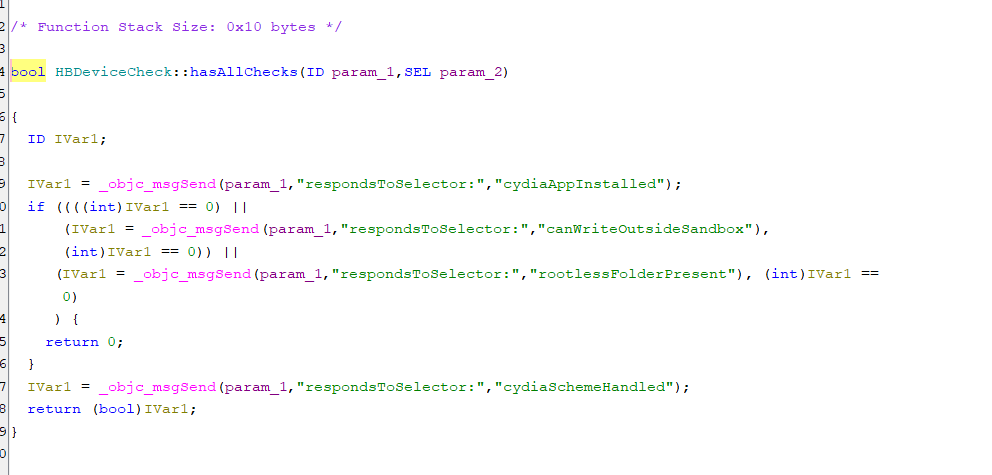
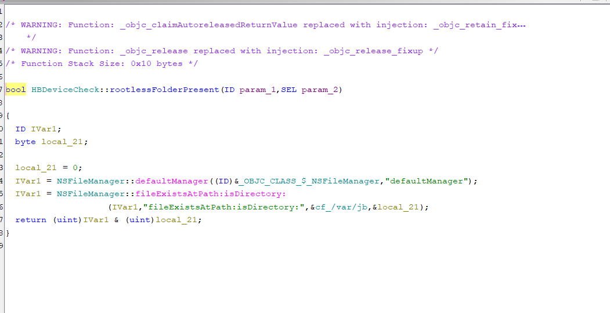
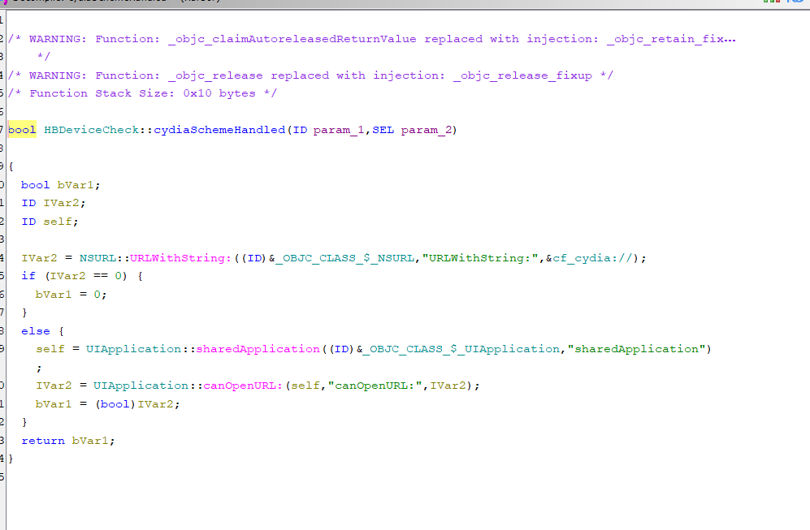
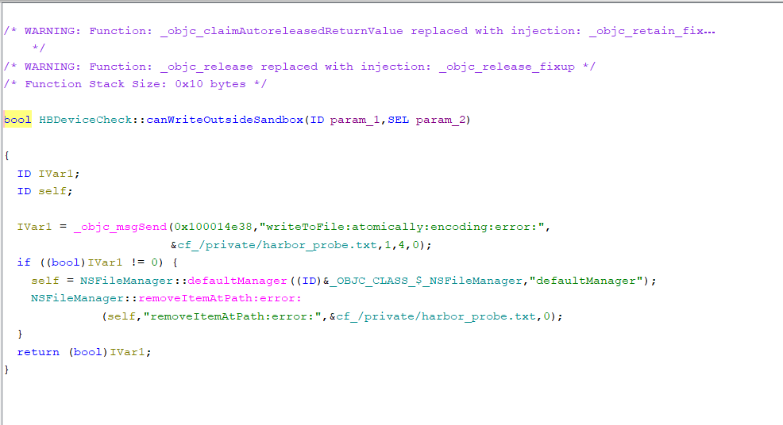
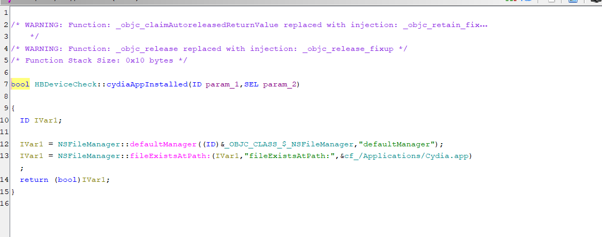
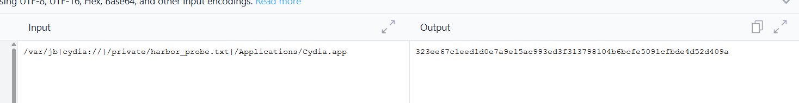

# Task 2 — Harbor (iOS · 500 pts)

## Challenge

> Harbor keeps ferry tickets on the phone, and refuses to show them on a
> jailbroken iPhone. Before it opens the ticket list, it runs four checks one
> after the other. Each check looks at one thing: a path on disk or a URL.
>
> Find the four things, in the order the app checks them, and write each one
> exactly as it appears in the binary. Join them with `|`, with no spaces. The
> flag is `Cybercamp{` + the first 16 hex characters of the SHA-256 of that
> string + `}`.

**Provided file:** `Harbor.ipa`



---

## Step 1 — Unpack and load into Ghidra

Unzipped `Harbor.ipa` to get `Payload/Harbor.app/Harbor`, loaded the Mach-O
executable into Ghidra, and searched defined strings/symbols for the device
jailbreak-detection class `HBDeviceCheck`. Four relevant methods turned up:

- `hasAllChecks` — the orchestrator that runs all four checks
- `cydiaAppInstalled`
- `canWriteOutsideSandbox`
- `rootlessFolderPresent`
- `cydiaSchemeHandled`

---

## Step 2 — The orchestrator: `hasAllChecks`

```c
bool HBDeviceCheck::hasAllChecks(ID param_1, SEL param_2)
{
  ID IVar1;

  IVar1 = _objc_msgSend(param_1,"respondsToSelector:","cydiaAppInstalled");
  if ((((int)IVar1 == 0) ||
      (IVar1 = _objc_msgSend(param_1,"respondsToSelector:","canWriteOutsideSandbox"),
      (int)IVar1 == 0)) ||
      (IVar1 = _objc_msgSend(param_1,"respondsToSelector:","rootlessFolderPresent"),
      (int)IVar1 == 0)
     ) {
    return 0;
  }
  IVar1 = _objc_msgSend(param_1,"respondsToSelector:","cydiaSchemeHandled");
  return (bool)IVar1;
}
```



---

## Step 3 — Each individual check

### `rootlessFolderPresent` → `/var/jb`

```c
bool HBDeviceCheck::rootlessFolderPresent(ID param_1, SEL param_2)
{
  ...
  IVar1 = NSFileManager::fileExistsAtPath:isDirectory:
            (IVar1, "fileExistsAtPath:isDirectory:", &cf_/var/jb, &local_21);
  return (uint)IVar1 & (uint)local_21;
}
```



### `cydiaSchemeHandled` → `cydia://`

```c
bool HBDeviceCheck::cydiaSchemeHandled(ID param_1, SEL param_2)
{
  IVar2 = NSURL::URLWithString:((ID)&_OBJC_CLASS_$_NSURL,"URLWithString:",&cf_cydia://);
  ...
  IVar2 = UIApplication::canOpenURL:(self,"canOpenURL:",IVar2);
  bVar1 = (bool)IVar2;
  return bVar1;
}
```



### `canWriteOutsideSandbox` → `/private/harbor_probe.txt`

```c
bool HBDeviceCheck::canWriteOutsideSandbox(ID param_1, SEL param_2)
{
  IVar1 = _objc_msgSend(0x100014e38,"writeToFile:atomically:encoding:error:",
                         &cf_/private/harbor_probe.txt,1,4,0);
  if ((bool)IVar1 != 0) {
    ... NSFileManager::removeItemAtPath:error:(..., &cf_/private/harbor_probe.txt, 0);
  }
  return (bool)IVar1;
}
```



### `cydiaAppInstalled` → `/Applications/Cydia.app`

```c
bool HBDeviceCheck::cydiaAppInstalled(ID param_1, SEL param_2)
{
  IVar1 = NSFileManager::defaultManager(...);
  IVar1 = NSFileManager::fileExistsAtPath:(IVar1,"fileExistsAtPath:",
                                            &cf_/Applications/Cydia.app);
  return (bool)IVar1;
}
```



---

## Step 4 — Join order and hash

Four values found, joined in check order with `|`:

```
/var/jb|cydia://|/private/harbor_probe.txt|/Applications/Cydia.app
```

SHA-256 of that exact string, first 16 hex characters:



```
SHA-256: 323ee67c1eed1d0e7a9e15ac993ed3f313798104b6bcfe5091cfbde4d52d409a
First 16 hex chars: 323ee67c1eed1d0e
```

---

## Flag

```
Cybercamp{323ee67c1eed1d0e}
```

---

## Notes

- All four checks are classic iOS jailbreak-detection heuristics: a known
  jailbreak app bundle (`Cydia.app`), a known rootless-jailbreak path prefix
  (`/var/jb`), a custom URL scheme a jailbreak tool registers (`cydia://`),
  and a sandbox-escape write test to a path outside the app's own container
  (`/private/harbor_probe.txt`).
- `hasAllChecks` short-circuits on the first three checks via `||`, then
  independently evaluates the fourth (`cydiaSchemeHandled`) regardless of the
  first three's outcome, as long as they all passed.
