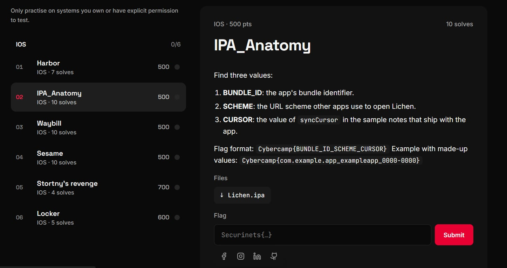
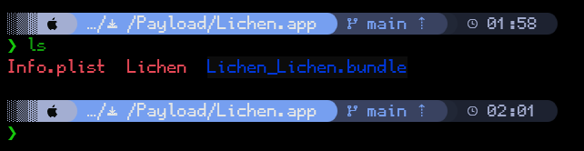
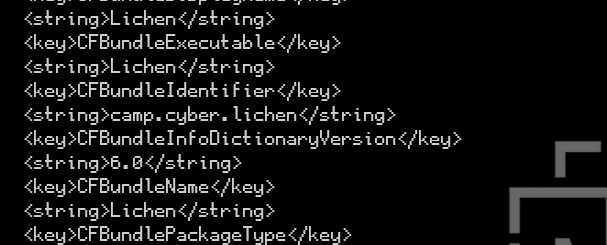
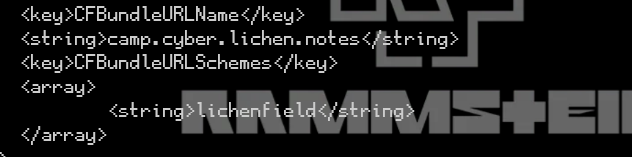
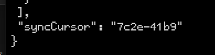

# Task 1 — IPA_Anatomy (iOS · 500 pts)

## Challenge

> Find three values:
> 1. **BUNDLE_ID**: the app's bundle identifier.
> 2. **SCHEME**: the URL scheme other apps use to open Lichen.
> 3. **CURSOR**: the value of `syncCursor` in the sample notes that ship with the app.
>
> Flag format: `Cybercamp{BUNDLE_ID_SCHEME_CURSOR}`

**Provided file:** `Lichen.ipa`



---

## Step 1 — Unpack the IPA

An `.ipa` is just a zip archive containing a `Payload/` directory with the
`.app` bundle inside:

```bash
unzip Lichen.ipa
```

Resulting structure:

```
Payload/Lichen.app/
├── Info.plist
├── Lichen                  (the executable)
└── Lichen_Lichen.bundle/
```



---

## Step 2 — Convert the Info.plist to readable JSON

iOS `Info.plist` files are binary property lists, so a human-readable dump is
easiest to grep through:

```bash
python3 -c "import plistlib,json; print(json.dumps(
plistlib.load(open('Info.plist','rb')), indent=1,
default=str))" > info.json
```

Run from inside `Payload/Lichen.app/` for the main plist.

---

## Step 3 — Extract BUNDLE_ID and SCHEME

From `Payload/Lichen.app/Info.plist` → `info.json`:

```xml
<key>CFBundleIdentifier</key>
<string>camp.cyber.lichen</string>
```



```xml
<key>CFBundleURLName</key>
<string>camp.cyber.lichen.notes</string>
<key>CFBundleURLSchemes</key>
<array>
    <string>lichenfield</string>
</array>
```



| Value | Result |
|---|---|
| **BUNDLE_ID** | `camp.cyber.lichen` |
| **SCHEME** | `lichenfield` |

---

## Step 4 — Extract CURSOR from the bundled sample notes

The app ships a resource bundle, `Lichen_Lichen.bundle`, separate from the
main `Info.plist`. Running the same plist-to-JSON conversion on the data
inside that bundle (the sample notes payload) reveals:

```json
"syncCursor": "7c2e-41b9"
```



| Value | Result |
|---|---|
| **CURSOR** | `7c2e-41b9` |

---

## Flag

```
Cybercamp{camp.cyber.lichen_lichenfield_7c2e-41b9}
```

---

## Notes

- No reverse engineering of the executable itself was needed for this task —
  everything required was sitting in plaintext inside the two plists. This is
  typical of an "anatomy" / IPA-structure warm-up challenge: the goal is
  familiarity with IPA layout (`Payload/`, `Info.plist`, bundled resources)
  rather than binary analysis.
