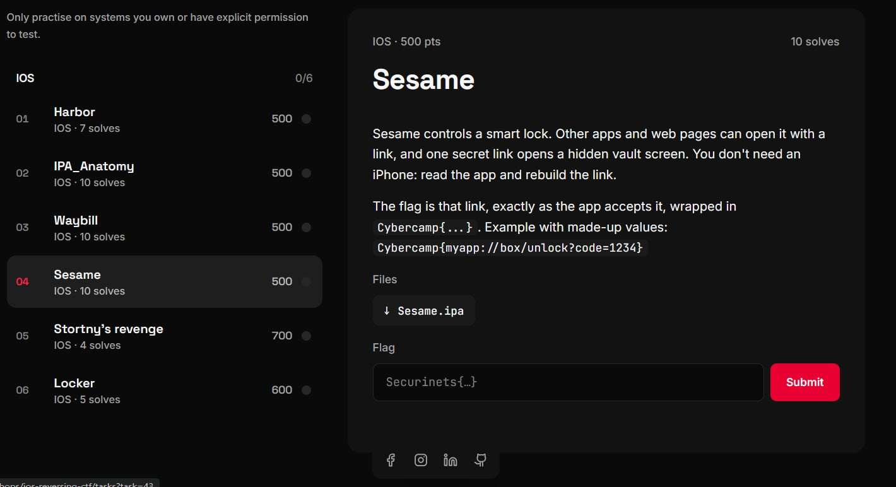
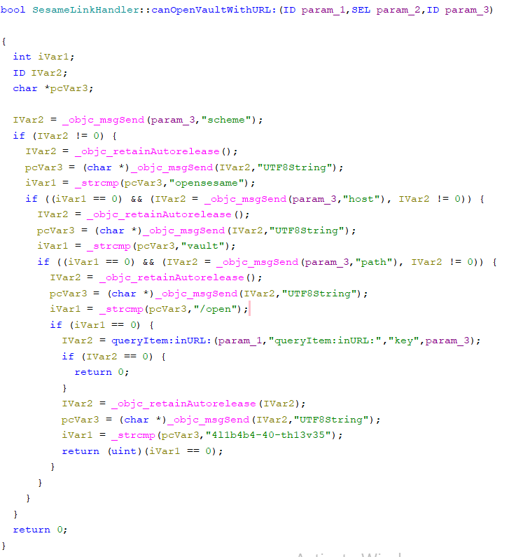

# Task 4 — Sesame (iOS · 500 pts)

## Challenge

> Sesame controls a smart lock. Other apps and web pages can open it with a
> link, and one secret link opens a hidden vault screen. You don't need an
> iPhone: read the app and rebuild the link.
>
> The flag is that link, exactly as the app accepts it, wrapped in
> `Cybercamp{...}`. Example with made-up values:
> `Cybercamp{myapp://box/unlock?code=1234}`

**Provided file:** `Sesame.ipa`



---

## Step 1 — Find the URL handler

Unzipped `Sesame.ipa`, loaded `Payload/Sesame.app/Sesame` into Ghidra, and
located the class responsible for handling incoming deep links:
`SesameLinkHandler`. Its key method, `canOpenVaultWithURL:`, is the gate that
decides whether an incoming URL is allowed to open the hidden vault screen.



---

## Step 2 — Read the validation logic

```c
bool SesameLinkHandler::canOpenVaultWithURL:(ID param_1, SEL param_2, ID param_3)
{
  IVar2 = _objc_msgSend(param_3, "scheme");
  if (IVar2 != 0) {
    pcVar3 = UTF8String(IVar2);
    iVar1 = strcmp(pcVar3, "opensesame");
    if (iVar1 == 0 && (IVar2 = _objc_msgSend(param_3,"host"), IVar2 != 0)) {
      pcVar3 = UTF8String(IVar2);
      iVar1 = strcmp(pcVar3, "vault");
      if (iVar1 == 0 && (IVar2 = _objc_msgSend(param_3,"path"), IVar2 != 0)) {
        pcVar3 = UTF8String(IVar2);
        iVar1 = strcmp(pcVar3, "/open");
        if (iVar1 == 0) {
          IVar2 = queryItem:inURL:(param_1, "queryItem:inURL:", "key", param_3);
          if (IVar2 == 0) { return 0; }
          pcVar3 = UTF8String(IVar2);
          iVar1 = strcmp(pcVar3, "4l1b4b4-40-th13v35");
          return (uint)(iVar1 == 0);
        }
      }
    }
  }
  return 0;
}
```

This is a strict, nested AND chain over the standard URL components
(`scheme://host/path?query`). Every check must pass for the function to
return `true`:

| URL component | Required value |
|---|---|
| **scheme** | `opensesame` |
| **host** | `vault` |
| **path** | `/open` |
| **query param `key`** | `4l1b4b4-40-th13v35` |

Any mismatch at any stage short-circuits the `if` chain and returns `0`
immediately — the function never reaches the final `key` comparison unless
scheme, host, and path all matched first.

---

## Step 3 — Rebuild the URL

Assembling the four required pieces into standard URL syntax:

```
opensesame://vault/open?key=4l1b4b4-40-th13v35
```

The required `key` value, `4l1b4b4-40-th13v35`, is leetspeak for
"Ali Baba and the 40 thieves" — a thematic nod to "open sesame," the magic
phrase from the story that opens the thieves' treasure cave.

---

## Flag

```
Cybercamp{opensesame://vault/open?key=4l1b4b4-40-th13v35}
```

---

## Notes

- No iPhone or simulator was needed to solve this — the task explicitly says
  so, and indeed the entire solution comes from reading the decompiled
  `strcmp` chain and reconstructing the URL that satisfies every branch.
- This is a classic custom-URL-scheme deep-link validation pattern: an app
  registers a scheme (`opensesame://`) and inspects the resulting `NSURL`'s
  `scheme`, `host`, `path`, and query items to decide what action to take.
  Here the "vault" host + "/open" path + a hardcoded secret key act as a
  weak, client-side-only access control that's trivially recoverable by
  reversing the binary.
