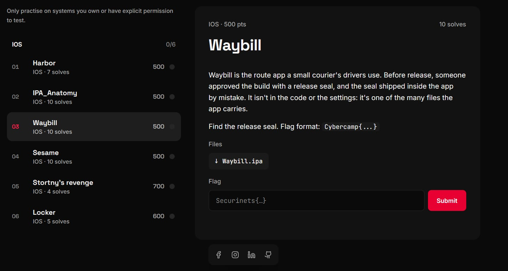
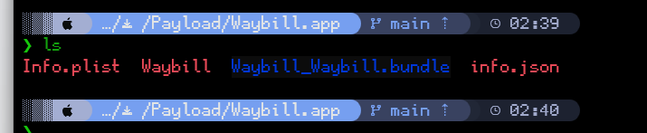
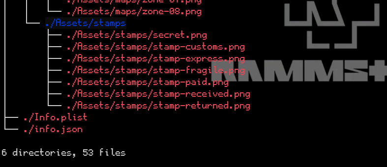
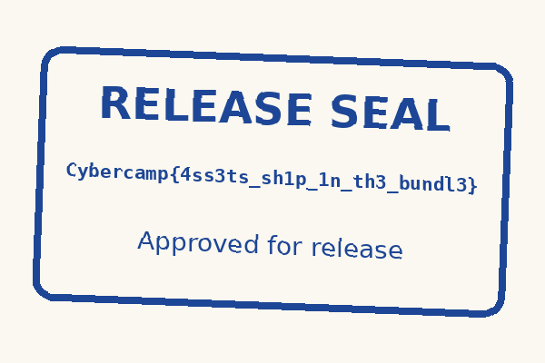

# Task 3 — Waybill (iOS · 500 pts)

## Challenge

> Waybill is the route app a small courier's drivers use. Before release,
> someone approved the build with a release seal, and the seal shipped inside
> the app by mistake. It isn't in the code or the settings: it's one of the
> many files the app carries.
>
> Find the release seal. Flag format: `Cybercamp{...}`

**Provided file:** `Waybill.ipa`



---

## Step 1 — Unpack the IPA

```bash
unzip Waybill.ipa
```

```
Payload/Waybill.app/
├── Info.plist
├── Waybill                     (executable)
├── Waybill_Waybill.bundle/
└── info.json
```



---

## Step 2 — Enumerate the app's bundled assets

The challenge hint says the seal "isn't in the code or the settings" — it's
"one of the many files the app carries." That points directly at
`Waybill_Waybill.bundle`, the resource bundle shipped alongside the binary.
Listing its full directory tree:

```bash
find Waybill_Waybill.bundle -type f
```

```
6 directories, 53 files
```

Most of the tree is exactly what you'd expect from a courier app: map tiles
(`./Assets/maps/zone-01.png` ... `zone-08.png`) and legitimate shipping
stamps (`stamp-customs.png`, `stamp-express.png`, `stamp-fragile.png`,
`stamp-paid.png`, `stamp-received.png`, `stamp-returned.png`).

Sitting right alongside those stamp images, in the same `./Assets/stamps/`
folder, is one file that doesn't fit the naming pattern:

```
./Assets/stamps/secret.png
```



---

## Step 3 — Open the out-of-place asset

```bash
open Waybill_Waybill.bundle/Assets/stamps/secret.png
```

The image is a "RELEASE SEAL" graphic — the exact artifact described in the
challenge text — with the flag printed directly on it in plain text:



---

## Flag

```
Cybercamp{4ss3ts_sh1p_1n_th3_bundl3}
```

---

## Notes

- The flag itself is a leetspeak hint confirming the lesson of the challenge:
  "assets ship in the bundle" — a reminder that any file packed into an app's
  resource bundle ships to every device that installs it, whether or not it's
  referenced anywhere in code, storyboards, or settings.
- No reverse engineering of the executable was needed; this was purely an
  asset-enumeration exercise. The only trick was knowing to look past the
  binary/plist/settings and treat the bundle's file tree itself as the attack
  surface.
